# ADHD-200 three-class classification with an explainable "AI Assistant"

The pipeline compares nine class-balancing strategies across five classifiers, tunes the winner with four metaheuristics and Optuna, and explains the final model with SHAP and DiCE (together called the *AI Assistant* in the paper).

Only phenotypic variables are used; no imaging features.

## Highlights

- 973 ADHD-200 participants, 947 labelled, 505 complete cases (271 control / 130 combined / 104 inattentive).
- 45 balancer × classifier combinations, scored with repeated stratified 5-fold CV (3 repeats) on the training set; selection metric is macro-F1.
- Winner: logistic regression + SMOTE; tuned C ≈ 0.30 (WOA, matched by Optuna).
- Held-out test set (n = 127): accuracy 0.866, balanced accuracy 0.833, macro-F1 0.826, macro one-vs-rest AUC 0.95.
- SHAP (global and per-participant) and DiCE counterfactuals explain the model.

## Repository layout

```
notebooks/
  01_cleaning_multiclass.ipynb          raw TSV -> adhd_cleaned_multiclass.csv
  02_EDA_before_after_cleaning.ipynb    missingness, class evolution, distributions
  03_ADHD_MAIN_multiclass.ipynb         balancing, model selection, tuning, SHAP, DiCE
assets/figures/                         figures used in this README (from the paper)
data/README.md                          how to obtain and regenerate the data
requirements.txt
```

## Quick start

```bash
python -m venv .venv && source .venv/bin/activate
pip install -r requirements.txt
```

The analyses in the paper were run with Python 3.12. Then follow [data/README.md](data/README.md) and run the three notebooks in order. All seeds are fixed to 42.

## Data and cleaning

`01_cleaning_multiclass.ipynb`:

- reads every column as text, then turns `pending`, `N/A` and `-999` into missing values;
- harmonizes handedness (NYU Edinburgh scores to 0/1/2, NeuroIMAGE value 3 to 2, `L` to 0);
- drops the participant ID, site, two QC flags, Full2 IQ, secondary diagnosis and medication status;
- recodes `DX` to 0 control, 1 ADHD-combined (hyperactive/impulsive merged in), 2 ADHD-inattentive;
- keeps complete cases only (947 → 505).

| Stage | Control | ADHD-combined | ADHD-inattentive | Total |
|---|---|---|---|---|
| Labelled (H/I merged into combined) | 585 | 225 | 137 | 947 |
| Complete cases | 271 | 130 | 104 | 505 |
| Training (75%) | 203 | 97 | 78 | 378 |
| Test (25%) | 68 | 33 | 26 | 127 |

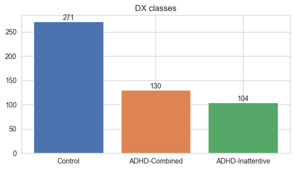

*Fig. 1. Distribution of the three diagnostic classes in the final dataset (n = 505).*

Supplementary exploratory figures from `02_EDA_before_after_cleaning.ipynb`:

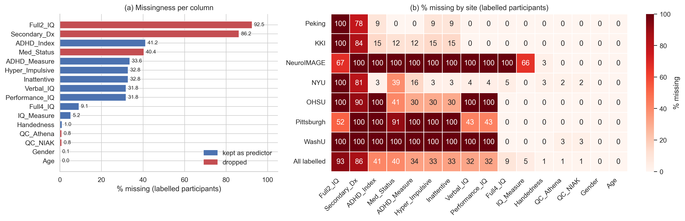

*Fig. S1. Missingness in the raw phenotypic file. (a) Per column (kept predictors in blue, dropped columns in red); (b) per column at each of the eight sites.*

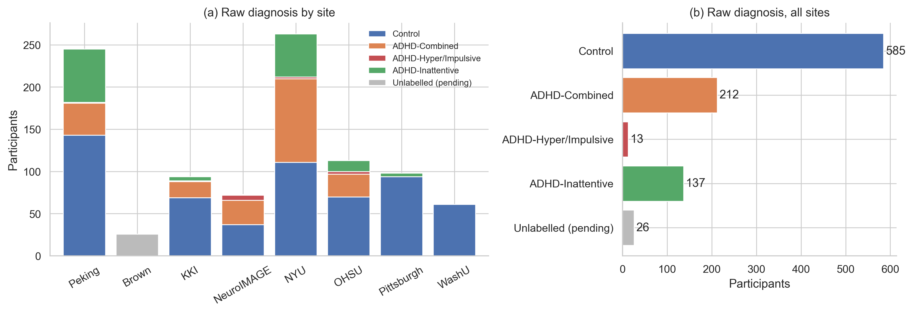

*Fig. S2. Raw diagnostic composition before merging or filtering. (a) By site; (b) totals (n = 973).*

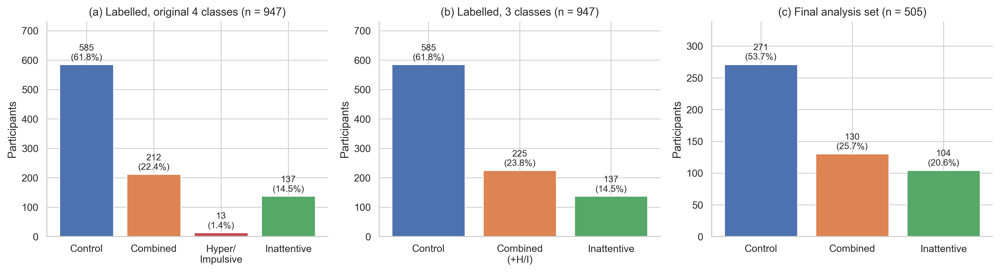

*Fig. S3. From raw labels to the final analysis set: (a) four original classes, (b) after merging, (c) after complete-case filtering.*

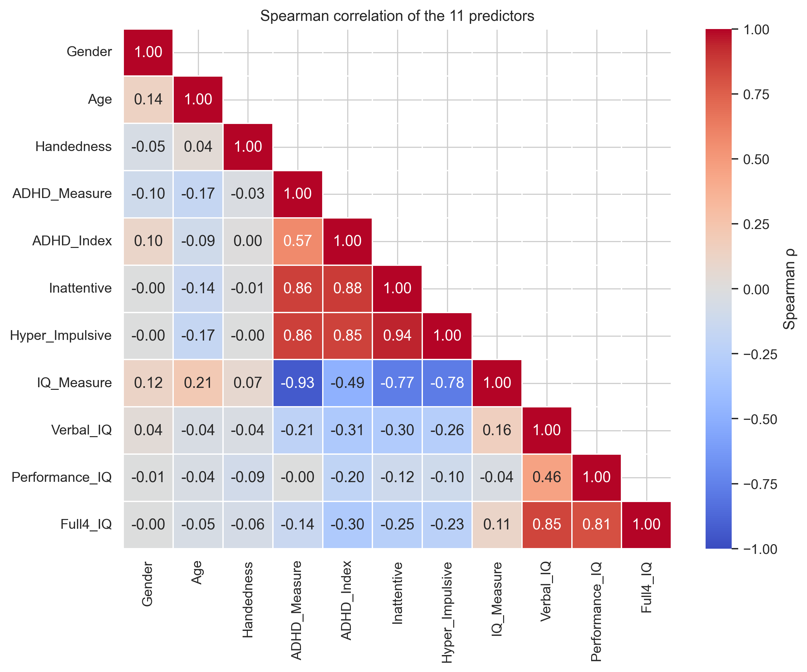

*Fig. S4. Spearman correlation matrix of the 11 predictors (n = 505).*

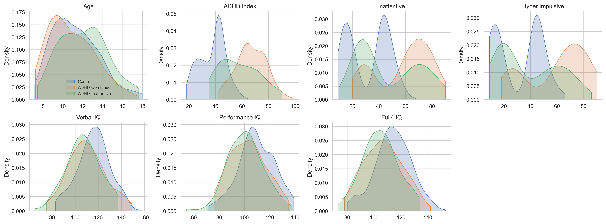

*Fig. S5. Numeric predictors by diagnostic class.*

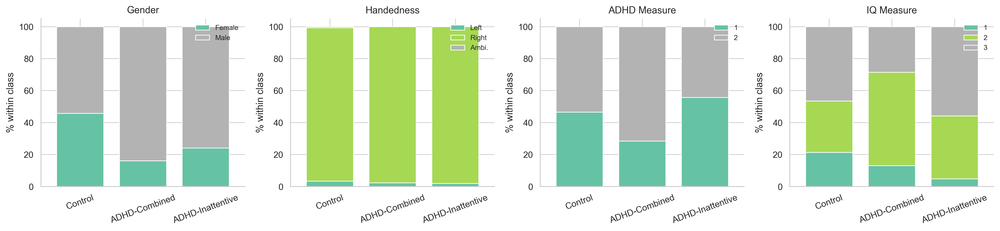

*Fig. S6. Categorical predictors within each class (percentages within class).*

## Modeling pipeline

One `imblearn` pipeline is refitted inside every CV fold, so scaling and synthetic samples never touch validation or test data:

`StandardScaler` (7 numeric) + `OneHotEncoder` (Gender, Handedness, ADHD_Measure, IQ_Measure) → sampler → classifier

- **Balancers (9):** none, random oversampling, SMOTE, Borderline-SMOTE, SVM-SMOTE, ADASYN, SMOTE-Tomek, SMOTE-ENN, random undersampling.
- **Classifiers (5):** logistic regression, k-NN, SVM (RBF), random forest (300 trees), XGBoost.
- **Tuning:** GWO, GA, PSO, WOA (MEALPY) and Optuna TPE on the logistic-regression + SMOTE pipeline; 320 evaluations each, 5-fold CV fitness. The final configuration is picked by repeated CV on different folds, not by the test set.

## Results

### Balancing and model selection

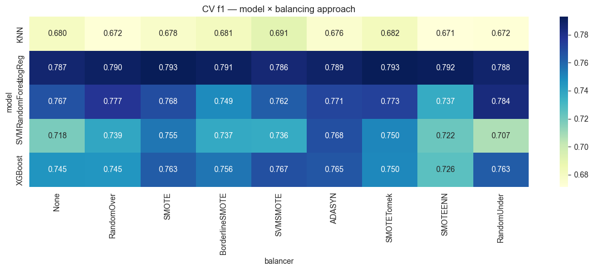

*Fig. 2. Cross-validated macro-F1 for each classifier and balancing strategy.*

Logistic regression was the strongest and most stable classifier (0.786–0.793 for every balancer); SMOTE and SMOTE-Tomek tied at 0.793, and SMOTE was kept as the simpler option. Gaps among the leading combinations are under 0.01 and were not tested for significance.

### Hyperparameter tuning

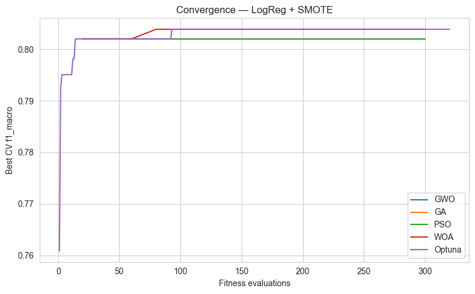

*Fig. 3. Convergence of GWO, GA, PSO, WOA and Optuna (best 5-fold macro-F1 against fitness evaluations).*

| Configuration | C | CV macro-F1 (repeated) | Test accuracy | Test macro-F1 | Test macro AUC |
|---|---|---|---|---|---|
| Default | 1.000 | 0.793 | 0.866 | 0.826 | 0.947 |
| **WOA (selected)** | 0.296 | 0.804 | 0.866 | 0.826 | 0.95 |
| Optuna | 0.297 | 0.804 | 0.866 | 0.826 | 0.95 |
| GA | 8.518 | 0.792 | 0.874 | 0.839 | 0.947 |
| GWO | 6.009 | 0.792 | 0.874 | 0.839 | 0.947 |
| PSO | 11.846 | 0.790 | 0.874 | 0.839 | 0.947 |

Tuning gave at most a marginal gain over the default model.

### Test-set performance

| Class | Precision | Recall | F1 | Support |
|---|---|---|---|---|
| Control | 0.985 | 0.941 | 0.962 | 68 |
| ADHD-combined | 0.812 | 0.788 | 0.800 | 33 |
| ADHD-inattentive | 0.667 | 0.769 | 0.714 | 26 |
| Macro average | 0.821 | 0.833 | 0.826 | 127 |

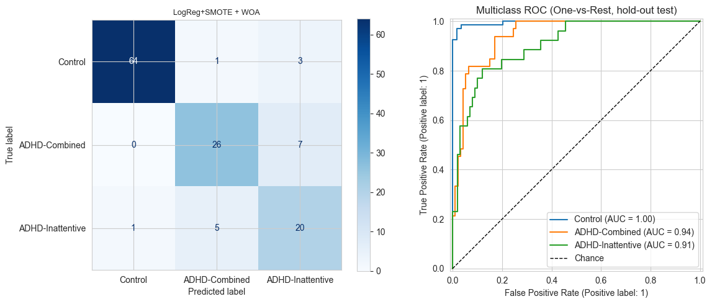

*Fig. 4. Confusion matrix and one-vs-rest ROC curves on the test set. Most mistakes are between the two ADHD groups.*

## AI Assistant: SHAP and DiCE

**SHAP** uses the permutation explainer on the whole pipeline (100 training rows as background, probability space, one output per class), so attributions refer to the original variables.

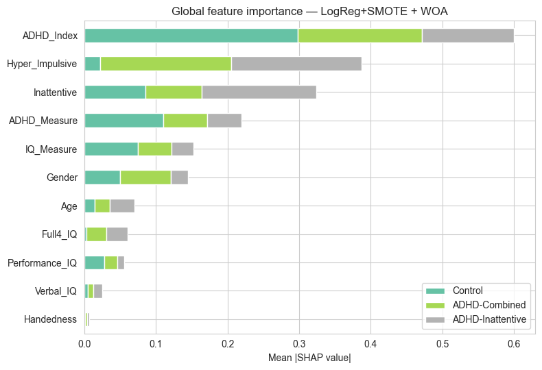

*Fig. 5. Global feature importance (mean |SHAP|, stacked by class). ADHD Index ≈ 0.60, Hyper/Impulsive ≈ 0.39, Inattentive ≈ 0.32.*

| (a) Control | (b) ADHD-combined |
|---|---|
| 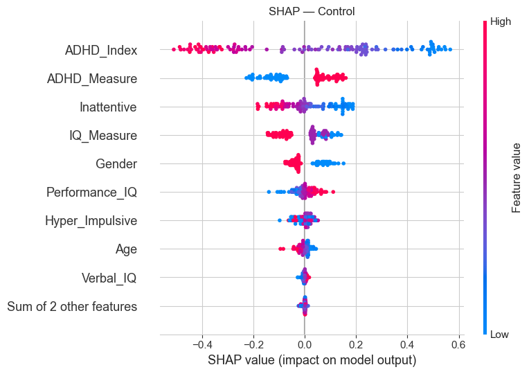 | 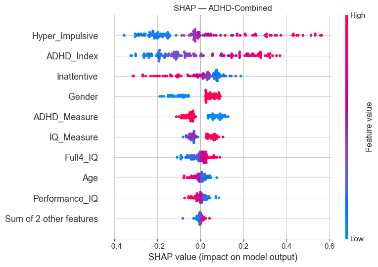 |

*Fig. 6. SHAP beeswarm plots. A low ADHD Index pushes toward control; a high Hyper/Impulsive score pushes toward combined.*

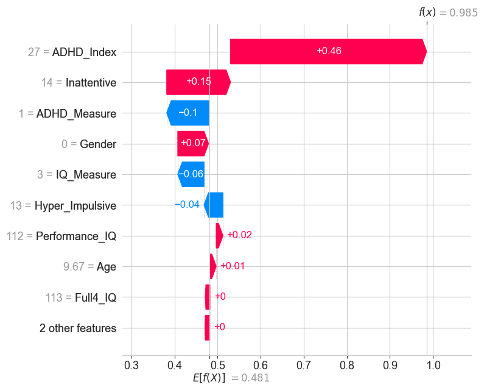

*Fig. 7. SHAP waterfall for one correctly classified control participant.*

| (a) Correctly classified control | (b) Misclassified ADHD-combined |
|---|---|
| 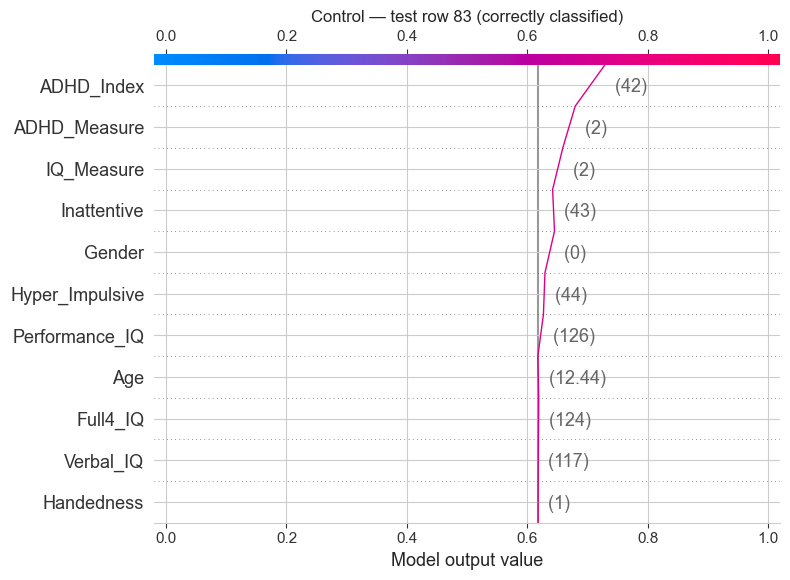 | 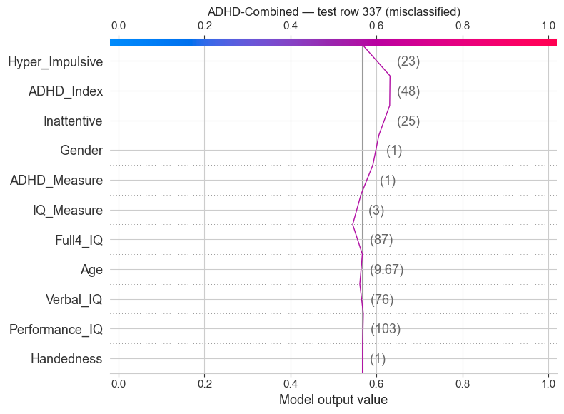 |

*Fig. 8. SHAP decision plots.*

**DiCE** (random-sampling method, four counterfactuals per query) answers "what would have to change for a different predicted class?". Only the six score variables (ADHD Index, Inattentive, Hyper/Impulsive, Verbal/Performance/Full4 IQ) may vary; demographic and instrument codes are held fixed. The notebook generates counterfactuals for all six class transitions.

## Limitations

- The three rating scales are near-diagnostic, so high performance is partly circular. The notebook has an `EXCLUDE` list to re-run without them.
- `ADHD_Measure` and `IQ_Measure` can act as site/instrument proxies.
- Single cohort, no external validation; complete-case filtering removed 47% of labelled participants; the test set has only 127 participants.
- The hyperactive/impulsive group (n = 13) was merged into ADHD-combined purely because of sample size.
- Explanations describe the model, not causal mechanisms, and counterfactuals are not clinical recommendations.

## Citation

If you use this code, please cite the accompanying paper: Coming soon...

The data come from the ADHD-200 consortium via the Preprocessed Connectomes Project:
Bellec P. et al. (2017). The Neuro Bureau ADHD-200 Preprocessed repository. *NeuroImage*, 144, 275–286. https://doi.org/10.1016/j.neuroimage.2016.06.034

## License

Code: MIT (see [LICENSE](LICENSE)). The ADHD-200 data are governed by their own terms and are not redistributed here.
